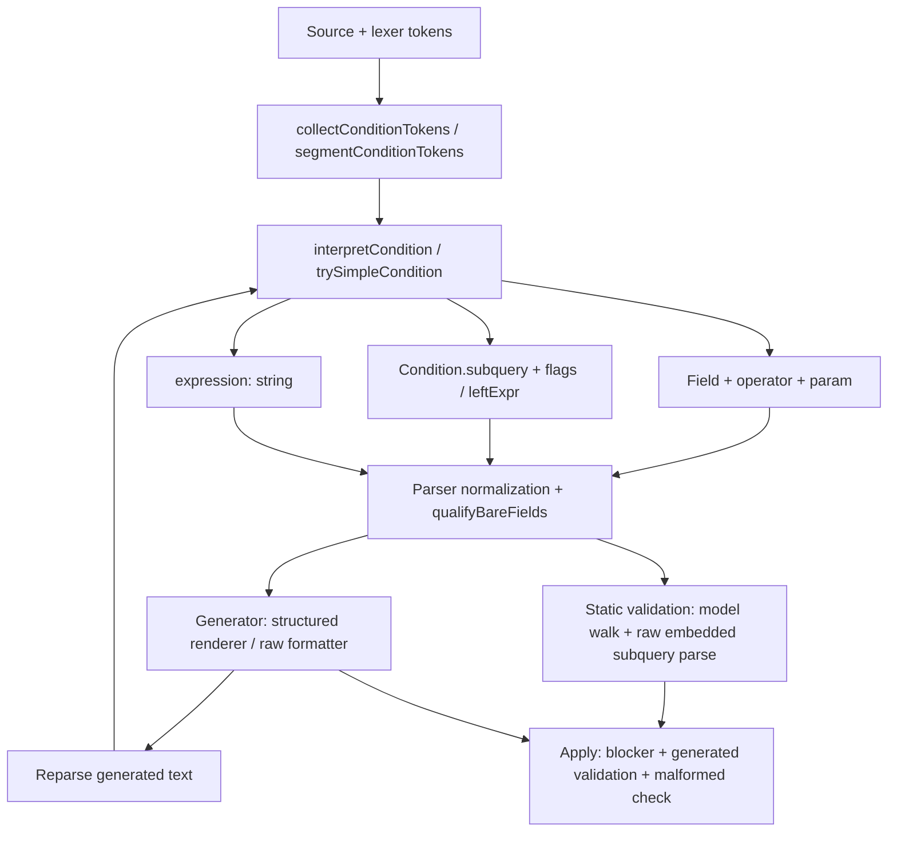

# Structured/raw expression: архітектурне дослідження

Дата: 2026-10-23. Scope: Parser → Condition Model → Generator → Validation → Apply.
Єдиний звіт об'єднує початкове дослідження, перевірку знахідок Claude, платформні
свідчення та узгоджений план впровадження. Повний corpus-прогін виконано на
`e0084c7f`; targeted verification — також на `d544557d` і `8f34dddb`.
Останній відповідав remote main на момент перевірки. Реліз v0.4.0 (`82d03b72`,
#98) змінив лише CHANGELOG і package-файли: його `src` ідентичний `8f34dddb`,
тому всі висновки про `8f34dddb` стосуються випущеної 0.4.0. Результати різних
ревізій не змішуються. Вихідний код harness і зведені дані доступні за
посиланнями у розділах 3 та 8.

Production-код, ledger, snapshots, fixtures і чужі scratch-worktrees не змінені.
Цей звіт — docs-only зміна; виправлення автоматично не починалися.

## Висновок

Підтверджена системна проблема — розподілене володіння синтаксисом виразу.
`Condition.custom` описує можливості редактора, але використовується поряд із
неявними ознаками представлення (`expression`, `subquery`, `leftExpr`, `param`).
Той самий синтаксис повторно розпізнають parser, два проходи кваліфікації,
formatter/generator і structural acceptor. Вибір маршруту залежить навіть від
розкладки тексту; raw не означає незмінність тексту. Apply перевіряє поточний і
згенерований запит, але не збереження його попередньої семантики чи причини відмови.

Рекомендація: **C — єдина проміжна модель умов із явним fallback**, поступово,
з A як спільною основою лексичних/нормалізаційних правил і B як механізмом
збереження оригіналу. Окремо A або B не усувають усіх підтверджених причин.
Це не пропозиція замінити весь QueryModel або технологію парсера.
Найнебезпечніші прояви (C46, operator-as-field, scalar NOT IN, C54) виправляються
локально в поточній моделі й ідуть першими, незалежно від рішення про IR
(розділ 6).

На перевіреному remote HEAD підтверджено чотири суттєві прояви:

- C46: невалідний JOIN `И И` стає `И ()`; після reopen Apply дозволений,
  хоча платформа відхиляє результат. Reopen досяжний у продукті без жодної
  правки: «Показать запрос» → «Применить» → OK записує `И ()` (розділ 4, R1).
- Кінцеве операторне слово (`НЕ` та інші) стає вигаданим полем `Т.НЕ`;
  Apply пропускає його також із metadata.
- Валідний scalar compact `Т.Ссылка НЕ В (…)` та double-NOT варіант
  помилково блокуються; multiline-форма проходить.
- C54: втрата дужок навколо запереченого операнда змінює результат виконання
  з 1 рядка на 0. Для membership subquery це стається між G1 і G2,
  хоча обидва Apply дозволені. Платформний canonical сам знімає ці дужки,
  тому виправлення означає свідоме відхилення від контракту ADR 0004.

Tuple-NOT із початкового baseline уже виправлений C51; його не слід подавати
як відкритий дефект remote HEAD. Конкретні знахідки Claude переважно правильні,
але твердження про відсутність інших семантичних змін на першому та другому Save
спростоване C54. Стабільний текст і platform-canonical equality самі по собі
не доводять збереження змісту.

## 1. Ревізії, межі доказів і статус C44–C54

| Ревізія | Роль |
|---|---|
| `e0084c7f5017af85ce89581d0fa9d40ed753b281` | Локальний main, початковий baseline, до C51 |
| `d544557d928008ccc8d6242ac9e0f371fc82ed80` | База scratch-worktree Claude, C51 / PR #96 |
| `8f34dddb5e1c11115b01c610775e76efa5b910d9` | origin/main і фактичний remote main, C52/C53 / PR #97 |

Remote підтверджено `git ls-remote origin refs/heads/main`; fetch/pull/reset не
виконувалися. Твердження про відставання локального main правильне, але він
відстає вже на **два** коміти. Початковий baseline не містив запису C51; на перевіреному remote вже є C51–C54.

| Запис | e0084c7f | Перевірений remote 8f34dddb / результат |
|---|---|---|
| C44 | CLOSED | Analysis і Apply відмовляють incomplete condition |
| C45 | CLOSED | Leading/trailing/empty AND зберігаються parser як custom і блокуються |
| C46 | OPEN P3 | Preview переписує empty conjunct; reopen знімає blocker |
| C47 | CLOSED | Source slicing використовує `Token.text.length`; English AND не обрізається |
| C48 | CLOSED | Broken subquery відмовляється і в model, і всередині raw |
| C49 | OPEN P2 | Raw-кваліфікація змінює structural word на field; platform-valid статус не доведений |
| C50 | CLOSED | Наявний depth-18 regression проходить; cache усунув експоненційний повторний parse |
| C51 | Запис відсутній | CLOSED у d544557d / #96; tuple-NOT виправлено |
| C52/C53 | Записи відсутні | CLOSED у 8f34dddb / #97; leading-NOT indent і multiline LHS normalization |
| C54 | Запис відсутній | OPEN P2; втрата operand parentheses, runtime зміна підтверджена |

Історичні причини й статуси зіставлено з ledger кожної ревізії; локальний
[ledger](../../technical-debt.md) лишається на e0084c7f. Нові номери боргу
не призначалися. Scalar NOT IN та operator-as-field описано як прояви R2/R3;
окремих tickets на кожен текстовий diff немає.

Існує суперечність: C49 називає grouping sets валідними, але
`coverage-areas.jsonl` має `group.grouping-sets: pending-platform-evidence`,
`probe-queue.jsonl` просить перевірку 8.3.20, а `c2-english.json` фіксує відмову
8.3.15. Чотири нові `validate_query` проби збережено в
[platform-probes.json](platform-probes.json): C46 invalid; tuple-NOT valid із
канонічним текстом; C49 structured і raw invalid. Поточний backend не повертає
build. Історичний build 8.3.15.1489 не переноситься на нові результати автоматично.
Ці чотири початкові проби перевіряли лише синтаксис/metadata. Під час
перевірки C54 окремо виконано чотири SELECT на константах/derived tables;
runtime результати й обмеження наведено в розділі 4.

## 2. Карта представлень і переходів

Основні файли: [parser](../../../../src/core/query/sdblParser.ts),
[model](../../../../src/core/query/queryModel.ts),
[qualifier](../../../../src/core/query/qualifyBareFields.ts),
[generator](../../../../src/core/query/sdblGenerator.ts),
[formatter](../../../../src/core/query/exprFormatter.ts),
[acceptor](../../../../src/core/query/expressionSyntaxCheck.ts),
[validator](../../../../src/core/query/semanticValidator.ts),
[Apply](../../../../src/webview/applyGate.ts).



### Маршрути в межах дослідження

| Межа / функції | Вибір представлення | Нормалізація / втрата provenance |
|---|---|---|
| `collectConditionTokens` → `segmentConditionTokens` | Верхній OR залишає всю секцію одним сегментом; інакше AND-list, з урахуванням BETWEEN/CASE/depth; empty AND не розщеплюється | AND-групи без OR рекурсивно сплющуються; первинні дужки/розкладка не зберігаються як окрема властивість |
| `interpretCondition` | Top-level OR, empty conjunct, unsupported форма → custom expression; bare field при одному source теж custom | Bare owner qualification, alias spelling; `(&Условие)` зберігається в preserve mode, constructor policy може зняти дужки |
| `trySimpleCondition` | Field-LHS + parameter-RHS → `custom:false`; IN-subquery → `custom:true, subquery`, зазвичай без expression; leading NOT → `negated` лише для успішного subquery path | Field reference переходить у tableId/path; spelling, пробіли й частина дужок більше не є джерелом істини |
| Nonparam RHS | Зазвичай `custom:true` + expression, але з дубльованими tableId/path/operator/param; складний formatter-trigger може лишити `custom:false` | Expression вже складається через `renderOperatorRhs` і `normalizeLeafCase`; це не original slice |
| Non-field LHS + IN | Compact SELECT/FROM, спеціальний HAVING-OR або підтримані comments можуть дати `leftExpr + subquery`; інші форми raw | Перенос рядка може переключити структурний маршрут у raw; compact gate шукає російські слова |
| Alias `В` | Перший top-level токен `В` може бути прочитаний як membership operator; простий path не спрацьовує | Та сама IN-форма з alias Т має модель subquery, з В — raw; alias В є platform-invalid контрольним випадком RP11 |
| Internal condition comments | Коментар усередині звичайного condition переводить його у custom expression; structured subquery має власне володіння comments | Edge comments мають anchors, внутрішні лишаються текстом; точне позиціювання не гарантується |
| JOIN `resolveJoin` / `classifyJoinConjunct` | Field↔field comparison за seed/joined ownership → structured; решта custom; є одночасно legacy `Join.expression` і `conditions[]` | Outer parens знімаються; edge comments розподіляються; generator надає пріоритет `conditions[]` |
| `qualifyBareFieldsInExpression` | Ранній parser-pass над raw RHS/condition; nested SELECT пропускає | Вставляє sole alias, нормалізує spelling; локальний `EXPR_STOP_WORDS`; source slice закінчується за `Token.text` |
| `qualifyBareFields` → `qualifyExpression` | Після побудови model обходить raw fields/conditions/HAVING/JOIN і структурні subqueries | Інший словник `STRUCTURAL`, metadata/outer scope; raw subquery парситься для контексту, але model викидається, переписується **весь текст тіла** за context першого member |
| `buildConditionStrings` | Непорожня custom expression має пріоритет над subquery; далі `leftExpr + subquery`, field+subquery, field+RHS | Raw: NOT-before-tuple, operand ordering, parens, case, layout; structured: окремий `renderOperatorRhs` / `renderConditionSubquery` |
| `expandAndChainConjuncts` / `renderJoinConjuncts` | Custom AND-chain знову розщеплюється перед друком | Інший splitter, без parser empty-conjunct refusal; порожня частина стає `()` — C46 |
| `reflowInlineMembershipSubquery` + formatter callback | Raw може тимчасово стати QueryDocument під час generation; compact/glued JOIN/OR/CASE gates | `parseDocument` → `renderConditionSubquery`, інакше текстовий reindent; тимчасова модель не повертається у Condition |
| Generated text → parser | Нова класифікація без пам'яті попереднього маршруту | Literal-LHS після canonical layout стає raw; JOIN може змінити legacy `custom`; початкова причина відмови втрачається |
| Validation | Structured subquery: walkDocument; raw: acceptor + `embeddedSubqueryTexts` → parseDocument → walkDocument | Raw validation створює ще одну тимчасову модель; C48 cache відокремлений від C50 qualification cache |
| Designer → store → Apply | Translate English → strict open → LOAD_BATCH → assemble → generate → static + click-time gates | Store snapshots не містять загального original-fragment contract; whole originalText у Apply використовується для template-marker safety, не equivalence |

### Де губиться original text

Lexer має оригінальний `text` і positions, parser Cursor має source. Але `Condition`
не зберігає immutable original source/span. Structured field/operator/param не
відновлює authored spelling/layout. Raw `expression` може вже бути переписаним
парсером, qualification або comment handling. `param` може лишитися застарілою
копією, коли пріоритет має `subquery` чи `expression`. Legacy JOIN дублює condition
text. Generator додає наступний етап переписування; на reopen лишається лише output.

Наявний [sourceMap](../../../../src/core/query/sourceMap.ts) — optional write-only
side channel для навігації. Він має JOIN/VT/subquery ranges, але не загальне
джерело кожного raw condition, не зберігає його оригінал у model/store і не є
дозволом переписувати текст. Його не можна просто оголосити рішенням B.

### Дубльовані правила

1. AND/OR/NOT, BETWEEN, CASE, depth і parens: parser segmenter, generator JOIN
   splitter/detectors, formatter boolean tree, acceptor. C45 і C46 розходяться на empty operand.
2. Word role / field ownership: `EXPR_STOP_WORDS`, `STRUCTURAL`, lexer boundary
   keywords, grammar-specific parser. C49: слово відоме group parser, але raw qualifier бачить поле.
3. Subquery boundary / context: `trySubqueryParam`, qualification substring walk,
   generator reflow і validation embedded-subquery walk. C48/C50 — наслідки
   повторного відкриття однієї структури різними споживачами.
4. Rendering: parser вже викликає `renderOperatorRhs`; generator використовує
   його для structured і довший ланцюг перетворень для raw. Спільний helper уже є,
   але його наявність не уніфікує усі правила.
5. Acceptance policy: strict open, `analyze`, Query Text acceptance, static Apply,
   generated revalidation. C44 виправив конкретну розбіжність, але спільний
   parser сам по собі не дає однакової політики для всіх представлень.

## 3. Harness і фіксована матриця контрактів

[Harness](../../../../tooling/research/structuredRawContracts.ts) — observational,
не переписує baselines. Для кожного input/mode:

`P1 → G1 → P2 → G2 → P3 → G3`.

Зберігає input і всі outputs, повні моделі та SHA-256 model, representation paths,
JSON paths структурних змін, logical token sequence (AND/OR/NOT), dotted paths,
SELECT count, literals, parameters; окремо `analyze` diagnostics, Designer open,
store-generated text, static blocker і `decideApply` з originalText.
Підзапити structured видно у повній моделі; raw body лишається у expression.
Token facts — сигнал, не semantic AST: AND усередині BETWEEN і слова-поля після
крапки не можна трактувати як незалежні логічні вузли. Повні тексти/моделі
дозволяють перевірити scope вручну. Помилка проходу завершує саме цей ланцюг,
не маскується як текстовий diff чи успішний Apply.

Core parse отримує resolver; Designer path використовує власний production
`tryOpenDesignerBatch`, який через `tryOpenBatch` парсить без resolver і використовує
resolver для semantic checks. Це навмисно окремі вимірювання, не однаковий режим
під іншою назвою. Початковий store ізольований, metadata надходить через resolver;
повний mounted UI/host-write тут не симулюється. Жодного запису в редактор.

Дані: [summary.json](summary.json). У summary — HEAD і хеші п'яти fixture-файлів.
Повні observations (`observations.jsonl.gz`, 3,6 МБ) і вибірка для читання
(`signals.json`, 2,4 МБ) не закомічені через розмір. Їх відтворює harness на
`e0084c7f` (команди в розділі 8); результат має збігтися з хешами в summary.
Кожен JSONL record має source/id/mode, тому diff має точне походження.

| Джерело | Inputs | Режими | Призначення |
|---|---:|---|---|
| Golden corpus, усі committed rows | 1 976 | без metadata / corpus YAML | Canonical baseline та три проходи |
| Grammar-parity catalog, усі entries | 153 | обидва | Позитивні, негативні, unknown controls |
| `c2-english`, `c40-scalar-subquery`, `v5-phase5-8.3.15` | 37 | обидва | Фіксований filter: WHERE/HAVING/JOIN або російські відповідники |
| Pairwise | 8 | обидва | 112/112 двофакторних комбінацій |
| Відомі ризики / controls | 24 | обидва | C44–C49, tuple, literals/comments, CASE, JOIN, HAVING, nested raw |
| Разом | **2 198** | **4 396 records** | До трьох проходів на record |
| Нові platform probes | 4 | connected backend | Окреме свідчення, поза local record count |

Числа 3 941/4 064 у старих audit/ledger не є кількістю committed golden rows на
цьому HEAD; поточний файл містить 1 976. Зовнішні/private corpora не підвантажувалися.

Pairwise factors (0/1): звичайні/подвійні пробіли; compact/multiline; без/із
outer parens; alias Т/В; без/із leading NOT; AND/OR; depth 1/2; scalar/tuple.
Детермінований greedy covering array вибирає 8 рядків із 256 кандидатів;
production pipeline запускається лише на 8. Усі 28 пар факторів × 4 значення
покриті; це не повний перебір. Alias В — свідомий негативний контроль.
Pairwise застосовано до WHERE; інші slots мають фіксовані controls і existing tests,
не заявляється повне перехресне покриття всіх контекстів.

### Незалежна перевірка знахідок Claude

Scratchpad Claude знайденов worktree `rt` на d544557d. Його `summary.txt` містить
`samples=10536 records=19755 pairwise=117 varied=7614`; 19 755 записів цілком
правдоподібні як обсяг того запуску, але вся ця матриця тут повторно не запускалась.

Незалежний probe: **30 точних прикладів × 2 metadata modes × 3 ревізії = 180 records**,
до трьох проходів кожен. Використано справжні Designer open, LOAD_BATCH,
assemble/generation, static blocker, `decideApply` з originalText і analysis.
Metadata — committed corpus YAML, не live database schema. Remote source
розпаковано через git archive в окремий тимчасовий каталог; чужий worktree лише
прочитано. Відомі слова перевірено bare і після `Т.Код = 1 И`; додано три
контекстні controls, compact/multiline/double-NOT/tuple, JOIN empty operands,
WHERE И і вже відомі C54 variants. Нового fuzzing не було.

Докази: [повні локальні observations](claude-verification-observations.jsonl.gz),
[probe source](claude-verification-probe.ts),
[platform validation і runtime responses](claude-platform-verification.json).
Backend SmartLogistic DEV не повертає build; не приписуємо йому історичну версію.

`B` = Apply заблокований; `A` = дозволений. Три символи — три послідовні проходи.
Однакова поведінка отримана без metadata і з corpus metadata, якщо не зазначено інше.

| Твердження / приклад | e0084c7f | d544557d | 8f34dddb | Висновок |
|---|---|---|---|---|
| Root/trailing operator word стає полем | AAA | AAA | AAA | Підтверджено локально для всіх 8 слів |
| `ГДЕ Т.Код = 1 И НЕ` генерує `… И Т.НЕ` | AAA | AAA | AAA | Платформа відхиляє і input, і output |
| HAVING/OR/JOIN із кінцевим НЕ блокуються | BBB | BBB | BBB | Підтверджено для трьох точних controls |
| JOIN `… И И …` | BAA | BAA | BAA | C46 підтверджено, уже відомий небезпечний reopen |
| JOIN `ПО И` | BAA | BAA | BAA | Також відмивається в JOIN |
| WHERE `ГДЕ И` | BBB | BBB | BBB | Узагальнення на будь-який порожній И неправильне |
| Compact `Т.Ссылка НЕ В (ВЫБРАТЬ … ИЗ …)` | BAA | BAA | BAA | Валідний input помилково блокується |
| Той самий NOT IN, внутрішній ИЗ на окремому рядку | AAA | AAA | AAA | Layout-dependent acceptance підтверджено |
| `НЕ т.Ссылка НЕ В (ВЫБРАТЬ … ИЗ …)` | BAA | BAA | BAA | Платформа приймає input; наш перший Apply блокує |
| Tuple `(Т.Код, Т.Наименование) НЕ В (…)` | BAA | AAA | AAA | C51 справді виправив цей випадок |
| C54 `(НЕ Т.Поле) В (…)` | AAA | AAA | AAA | Apply не захищає від зміни змісту |

Загальну layout-залежність підтверджено; конкретний scalar NOT IN приклад достатній.
Універсальне твердження про кожен WHERE/HAVING/JOIN без винятків із цих controls
не виводиться. Аналогічно, «усі HAVING/ПО/ИЛИ випадки безпечні» — сильніше за
перевірені три controls.

### Межі harness Claude

Переглянуто `roundtrip.ts`, `fingerprint.ts`, `sources.ts`, `analyze.py` і `cond.py`.
Це корисна дослідницька інфраструктура, але її висновки слід обмежити:

- Loose fingerprint стирає qualifiers, тому може приховати переприв'язку полів
  між різними sources. Він порівнює нормалізовані tokens/Boolean структуру,
  не доводить семантичну еквівалентність.
- Частину синтетики й grouping-sets прикладів `sources.ts` позначає `valid`
  без індивідуального platform verdict. Така мітка є припущенням harness,
  а не підтвердженням платформи; нею не можна автоматично доводити категорію 3.
- Comment-loss candidate в тому harness генерується без очікування UI consent;
  `decideApply` викликається без originalText, обходячи template-marker comparison;
  store round-trip не включений. Це обмежує заяву «точно такий Apply, як у продукті».
- Рівність fingerprint на відібраній матриці не доводить відсутності дефектів.
  Конкретний C54 змінює і fingerprint, і runtime результат; він спростовує
  універсальний висновок, а не доводить, що сам fingerprint його завжди пропускає.

Великий запуск не потрібно повторювати безмежно: для перевірки процитованих
тверджень достатні ці мінімальні controls і runtime контрприклади.

### Контракти, які варто розділяти

| Контракт | Поточний доказ / проблема | Майбутній gate |
|---|---|---|
| Canonical output | Golden byte-equality проходить; literals мають чинний preservation exception | Не змінювати oracle без обґрунтування |
| Text fixed point | `G1=G2=G3` на всіх golden | Окремий від model equality |
| Stable representation | 57 golden records змінюють representation P1→P2 | Вимагати стабільного IR-kind, дозволені adapters класифікувати |
| Stable structure | 673 golden records змінюють model P1→P2; P2→P3 стабільні | Порівнювати semantic projection, не raw JSON equality |
| Boolean/NOT/field/subquery preservation | Scalar LHS містить trailing `НЕ`; C54 змінює scope заперечення; raw roles C49 змінені | Tree/scopes/inventory та runtime controls до і після normalization |
| Acceptance parity | C44 baseline зелене; scalar compact NOT IN заблокований; tuple виправлений C51 | Analysis/Query Text/static/final gate користуються одним результатом |
| Refusal through no-edit reopen | C46 blocked→allowed, platform-invalid output | Нормалізація не стирає помилку; explicit edit окремий перехід |
| Store/Apply text | Golden без metadata: 0 різниць; corpus metadata: 6 | Порівнювати однакові policies/resolvers; окремо fixture mismatches |
| Bounded work | C50 depth tests проходять | Parse once per context/depth; cache не визначає correctness |

### Виміряні результати

У клітинках `без metadata / corpus metadata`. Counts — записи, не кількість
окремих текстових diff. Error означає початковий або пізніший parse failure.

| Набір | Initial errors | Later errors | G1≠G2 або G2≠G3 | Representation changes | First Apply allowed |
|---|---:|---:|---:|---:|---:|
| Golden | 0/0 | 0/0 | 0/0 | 57/57 | 1976/1976 |
| Grammar | 5/5 | 1/1 | 1/1 | 1/1 | 142/142 |
| Platform fixtures | 0/0 | 1/1 | 0/0 | 1/1 | 30/28 |
| Pairwise | 0/0 | 0/0 | 1/1 | 0/0 | 7/7 |
| Risk | 1/1 | 0/0 | 1/1 | 3/3 | 13/13 |

867/869 golden inputs змінюють текст при першій генерації; це не 867 дефектів.
Усі 673 model-drift записи стабілізуються P2→P3. Representation сигнали включають
legacy JOIN: 55 golden queries мають зміну JOIN custom/shape, один — condition
subquery/leftExpr; рахунки можуть перетинатися і не додаються до 57.
Не можна вимагати незмінності `aliasSynthesized`, derived aliases чи cached `param`
як семантичного контракту. Усі 1 976 golden Apply decisions стабільні.

6 golden store/Core розходжень у metadata mode пояснюються різним parse policy:
наприклад `CommonModules-ПользователиСлужебный-Ext-Module.bsl_39.txt` Core з metadata
прибирає user-IB predicate, тоді як Designer parse без metadata його зберігає.
Це не доказ втрати store і не привід включати metadata migration в цей scope.
English platform controls також відрізняють прямий Core output від Designer
translation. Повні тексти обох шляхів лишені у observations.

Grammar signals щодо зайвих VT arguments, sequence boundaries і scalar subqueries
належать уже наявним capability/grammar темам; їхні reopen-переходи записані,
але не породили нових задач у цьому дослідженні. Scalar-invalid controls можуть
не розібратися після першого output; це відокремлено від двох успішних генерацій.

## 4. Класи відхилень і мінімальні reproducer

Один кореневий клас — один workstream нижче. Номери R1–R4 локальні для звіту,
не нові ledger items. Клас може мати кілька категорій наслідків.

### R1. Неузгоджене розпізнавання Boolean operands: C45/C46

Категорія **1: небезпечний Apply**. Окремий критичний finding поточного baseline:

```sql
ВЫБРАТЬ А.Код ИЗ Справочник.Валюты КАК А
ЛЕВОЕ СОЕДИНЕНИЕ Справочник.Валюты КАК Б
ПО А.Код = Б.Код И И А.Код = 1
```

P1: один raw JOIN conjunct; static `malformedCustom`; Apply refused.
G1: `ПО А.Код = Б.Код И () И (А.Код = 1)` з layout.
P2/P3: перший conjunct structured, порожній лишається raw; **Apply allowed**;
G1=G2=G3. Платформа відхиляє G1: `Wrong parameters "И"` біля `()`.

Причина: parser C45 не розщеплює empty operands; generator
`expandAndChainConjuncts` розщеплює їх повторно; acceptor `acceptGroupContent`
дозволяє empty group, а після JOIN classification це може бути порожня expression.
Отже, синтаксично невалідний operand отримує форму, яку перевірки пропускають.
Стабільний текст і input/output validation не захистили від цього.

Перший Save blocker не обходить, але P2 досяжний у продукті без жодної правки
тексту (перевірено за кодом на 8f34dddb):

1. Query з `И И` відкрито, OK заблокований (`malformedCustom`).
2. «Показать запрос»: `handleShowQuery`
   ([ConstructorView](../../../../src/webview/components/ConstructorView.tsx))
   відкриває Query Text зі **згенерованим** текстом G1, тобто вже з `И ()`.
3. «Применить» у [QueryTextDialog](../../../../src/webview/components/QueryTextDialog.tsx)
   активна завжди; ознака змін тексту (`hasUnsavedChanges`) впливає лише на
   підтвердження закриття.
4. `handleApplyQueryEdit` відкриває G1 через `tryOpenDesignerBatch` і перевіряє
   `findMalformedCustomExpressions` — для P2 перевірка проходить (B→A у таблиці
   вище), далі `LOAD_BATCH`.
5. Static blocker зникає, OK пише в редактор platform-invalid `… И () И (…)`.

Отже, C46 — не косметичний P3, а запис невалідного запиту двома кліками.
Той самий шлях відмиває JOIN `ПО И`. Повний UI-сценарій (browser E2E) не
запускався; висновок спирається на код і на виміряні P1/P2 Apply decisions.

JOIN `… И И …` → `… И () И (…)`; JOIN `ПО И` → `ПО () И ()`.
Обидва сценарії мають B→A→A на всіх трьох ревізіях. Для першого output
платформна відмова вже записана у [початкових platform probes](platform-probes.json).
Кореневий `ГДЕ И` не розщеплюється і має B→B→B.
Це доповнює C46 / R1, а не утворює ще одну задачу.

C45 historical semantic loss — той самий клас неоднакового split/operand contract;
він уже закритий, повторно не відкривається. C46 слід переоцінити за severity
і доповнити цим сценарієм в окремому майбутньому PR. У цьому дослідженні ledger
навмисно не редагувався. Пошук інших empty-group проявів не продовжувався.

### R2. Presentation-dependent representation і неповний NOT/IN contract

Категорія **3: неправильне блокування валідного запиту**. Поточний прояв
на 8f34dddb — scalar NOT IN; нижче окремо відмічено вже виправлений tuple-випадок.

#### Scalar NOT IN і double-NOT

```sql
ВЫБРАТЬ Т.Код ИЗ Справочник.Валюты КАК Т
ГДЕ Т.Ссылка НЕ В (ВЫБРАТЬ Ш.Ссылка ИЗ Справочник.Валюты КАК Ш)
```

Платформа: valid, canonical `НЕ Т.Ссылка В …`.
Наша P1 model: `custom:true`, `leftExpr:"Т.Ссылка НЕ"`, `subquery`, без negated.
Validator відмовляє неправильно відокремленому LHS. Після layout/reopen умова
стає raw і blocker зникає. Double-NOT input також platform-valid, його canonical
починається `НЕ НЕ Т.Ссылка В …`; перший Apply у нас блокується.

C51 піднімає trailing НЕ лише для tuple через `isTupleTokens`; scalar-LHS не
охоплений. C52/C53 змінюють layout/indent, не це parser rule. Дефект існує вже
на e0084c7f до C51. Точний перший історичний коміт окремим bisect не встановлювався;
приписувати появу дефекту C51 або C52/C53 неправильно.

Це той самий R2 contract, що tuple/leftExpr/raw; потрібен системний NOT/membership
boundary, а не окреме правило для кожного LHS.

#### Tuple-NOT: історичний baseline, виправлено C51

```sql
ВЫБРАТЬ Т.Код ИЗ Справочник.Валюты КАК Т
ГДЕ (Т.Код, Т.Наименование) НЕ В
(ВЫБРАТЬ Х.Код, Х.Наименование ИЗ Справочник.Валюты КАК Х)
```

Для reproducer тіло subquery має бути compact, як у `risk:not-tuple` у harness.
P1: `leftExpr = "(Т.Код, Т.Наименование) НЕ"`, subquery present, negated absent.
`findMalformedCustomExpressions` перевіряє такий LHS окремо і блокує Apply.
Платформа приймає input; canonical починається `НЕ (Т.Код, Т.Наименование) В`.
Після G1 layout змінюється, P2 стає raw, `moveNotBeforeTuple` друкує G2 у
платформній формі (G2 байт-в-байт збігається з новим platform canonical);
P2/P3 Apply allowed. У збереженому вимірюванні:
blocked→allowed→allowed, G1≠G2=G3. Заперечення не втрачено; доведена помилка
класифікації/відмови і зайвий прохід нормалізації, не зміна результатів виконання.

На d544557d і 8f34dddb цей tuple input має Apply allowed уже з P1;
C51 переніс trailing НЕ в `negated`. Наявні C51 regression-тести проходять.

#### Нестабільність представлення

Менший control категорії **2: нестабільність представлення без спостереженої
зміни тексту/операторів**:

```sql
ВЫБРАТЬ Т.Код ИЗ Справочник.Валюты КАК Т
ГДЕ 1 В (ВЫБРАТЬ Х.Код ИЗ Справочник.Валюты КАК Х ГДЕ Х.Код = 1)
```

Compact input → `leftExpr + subquery`; canonical reopen → raw expression;
G1=G2=G3; Apply allowed на всіх проходах. Перенести `ИЗ` внутрішнього query на
окремий рядок — raw уже на P1. Цей ефект є і в committed golden
`CommonModules-АдресныйКлассификатор-Ext-Module.bsl_1.txt`.
Нестабільність kind підтверджена; semantic equivalence для довільних запитів
із цього факту не виводиться. R2 охоплює обидва прояви, не два ledger tickets.

#### C54: precedence і втрата змісту на першому або другому Save

Категорія **1: семантичне спотворення та небезпечний Apply**.

Це вже відомий OPEN C54 у remote ledger; автоматично виправляти його не починали.
Мінімальний runtime control без бізнес-таблиць:

```sql
ВЫБРАТЬ 1 КАК Результат
ИЗ (ВЫБРАТЬ ЛОЖЬ КАК Флаг) КАК Т
ГДЕ (НЕ Т.Флаг) В (ИСТИНА, ЛОЖЬ)
```

Input виконується з **1 рядком**. Перший generator output має
`ГДЕ НЕ Т.Флаг В (ИСТИНА, ЛОЖЬ)` і виконується з **0 рядків**.
Apply дозволений на всіх трьох ревізіях/режимах. Для false flag оригінал перевіряє
membership істини в множині обох Boolean значень; output заперечує membership
самого false flag. Це різні дерева операторів.

Контрприклад саме **другому Save**:

```sql
ВЫБРАТЬ 1 КАК Результат
ИЗ (ВЫБРАТЬ ЛОЖЬ КАК Флаг) КАК Т
ГДЕ (НЕ Т.Флаг) В
(ВЫБРАТЬ Ш.Флаг ИЗ
 (ВЫБРАТЬ ИСТИНА КАК Флаг ОБЪЕДИНИТЬ ВСЕ ВЫБРАТЬ ЛОЖЬ) КАК Ш)
```

Probe використовує compact inner SELECT/ИЗ (точний input у observations).
G1 зберігає `(НЕ Т.Флаг)` і дає **1 рядок**. P2 переходить на raw; G2 друкує
`НЕ Т.Флаг В (…)` і дає **0 рядків**; G3=G2. Apply allowed для G1 і G2.
Обидва виконані тексти взяті безпосередньо з генератора 8f34dddb.

Причина — `stripNegatedFieldParens` приймає довільний tail після `(НЕ field)`
і знімає дужки також із операнда membership. Це R1/R2 precedence boundary.
Додатковий важливий доказ: `validate_query` приймає обидва тексти й сам видає
canonical без цих дужок. Отже, canonical equality не є гарантією runtime equivalence.
Виконано тільки чотири SELECT на константах/derived tables, жодних змін даних.

**Конфлікт із контрактом.** [ADR 0004](../../decisions/0004-querymodel-round-trip-contract.md)
визначає коректність як `generateBatch(parseBatch(input)) === query_text`
платформи. Для C54 платформний `query_text` збігається з нашим зіпсованим
output: `validate_query` для `(НЕ Т.ПометкаУдаления) В (&П)` і для константного
reproducer повертає canonical без дужок. Тому:

- Виправлення C54 (зберегти дужки перед `В`) свідомо **розходиться** з canonical
  text платформи. Це не можна зробити тихо: потрібне окреме рішення в ledger
  (статус ACCEPTED, як C36) і запис у `ACCEPTED_DIVERGENCES`
  (`test/unit/grammarParity.catalog.test.ts`), або розширення ADR 0004 за
  зразком наявного literal-value exception: збереження змісту має пріоритет
  над canonical text.
- Якщо форма потрапить у golden або grammar-parity з oracle canonical, gate
  зафіксує саме цей diff; оновлювати oracle під наш output не можна.
- Найімовірніше, сам конструктор 1С втрачає зміст на цьому вводі. Це варто
  записати як platform behaviour, а не як нашу «помилку canonical».

Ledger C54 зараз просить лише platform probe; вона вже є (вище) і показує
обидва факти. Наступна межа C54 — рішення щодо divergence, потім фікс.

### R3. Raw syntax roles не мають authoritative структури / provenance

#### Operator-as-field: поточний дефект

Категорія **1: невалідний output проходить Apply**.

```sql
ВЫБРАТЬ Т.Код ИЗ Справочник.Валюты КАК Т ГДЕ Т.Код = 1 И НЕ
```

Після генерації: `ГДЕ Т.Код = 1 И Т.НЕ`. Apply дозволений уже на першому проході,
також із metadata. Для `НЕ, ВЫБОР, ЕСТЬ, МЕЖДУ, КОГДА, ПОДОБНО, В, NOT`
відтворено однаковий клас вставки owner alias: 16 controls на ревізію/режим.

Корінь: `interpretCondition` викликає `tryBareField` до остаточного розпізнавання
operator role. `tryBareField` приймає ident/keyword і відсікає literals, але не
весь набір операторних слів. C45 має окрему перевірку empty conjunct, яка
захистила И, але не самотнє НЕ як наступний непорожній segment. Після вставки
`Т.` acceptor бачить qualified field; semantic validation не перевіряє всі
raw references як structured fields. Metadata тому не рятує.

Платформа: input — `Syntax error`; output — **`Field not found "Т.НЕ"`**.
Це важливе уточнення: generated text не обов'язково синтаксично зламаний —
він містить вигадане поле. Шкода — прийняття невалідного output і зміна authored
operator у reference. Кожне з восьми слів окремо на live platform не перевірялося;
live verdict тут для мінімального НЕ reproducer.

Це один class під R3 (syntax roles/provenance), а не вісім нових tickets.

#### C49: кваліфікація structural word у raw subquery

C49, категорія **5: немає підтвердження platform-valid на потрібній версії**,
із підтвердженим локальним переписуванням:

```sql
ВЫБРАТЬ Т.Код ИЗ Справочник.Валюты КАК Т
ГДЕ Т.Код = 1 ИЛИ Т.Код В
(ВЫБРАТЬ Х.Код ИЗ Справочник.Валюты КАК Х
СГРУППИРОВАТЬ ПО ГРУППИРУЮЩИМ НАБОРАМ ((Х.Код), (Х.Наименование)))
```

Raw `qualifySubquerySpan` дістає context із parsed model, потім `qualifyExpression`
проходить увесь текст тіла; `STRUCTURAL` не має `ГРУППИРУЮЩИМ`, і з'являється
`Х.ГРУППИРУЮЩИМ`. Generator reparse/reflow додатково формує помилковий group list.
Вилучення `Т.Код = 1 ИЛИ` дає structured subquery без такої кваліфікації.
Raw Apply blocked, structured allowed; поточна платформа відхиляє **обидва inputs**.
Отже, формулювання «доведено блокується валідний запит» для C49 було б сильнішим
за дані. Потрібна конкретна modern-platform проба, уже визначена PQ-group.grouping-sets.

C47 — закритий прояв цього ж браку provenance: canonical `Token.value.length`
помилково використовувався як source length; `Token.text.length` виправив slicing.
C50 — закритий ресурсний прояв повторного відновлення subquery structure з raw:
parse parent + recursive textual walk дублювали роботу. Cache виправляє вартість,
але не робить raw body синтаксично структурованим і не виправляє C49.

Alias В / pairwise-5: кожен reopen додає до умови ще один сегмент ` В .`
(`И НЕ В. В .Код В …` → `И НЕ В. В . В .Код В …` → …). На 8f34dddb перевірено
8 проходів поспіль: текст росте на кожному, стабілізації не спостерігалось.
Межу росту не доведено. Apply у трьох виміряних проходах blocked. RP11 уже
platform-invalid; це негативний contextual-keyword control, не новий valid-query
дефект і не окрема задача.

### R4. Acceptance policy залежить від стадії та способу обходу

C44/C48 історично, обидва закриті. Мінімальні controls:

```sql
ВЫБРАТЬ Т.Код ИЗ Справочник.Валюты КАК Т ГДЕ Т.Код =
```

```sql
ВЫБРАТЬ Т.Код ИЗ Справочник.Валюты КАК Т
ГДЕ Т.Код = 1 ИЛИ Т.Код В
(ВЫБРАТЬ Х.Код ИЗ Справочник.Валюты КАК Х ГДЕ Х.Код = 1 И)
```

Tolerant parse зберігає custom text, але analysis/static/final Apply відмовляють.
Для modeled/raw inner subquery у поточній матриці однакова відмова.
Історична розбіжність: parse success трактувався як прийняття; raw SELECT група
пропускалася acceptor за балансом, structured QueryDocument обходився повністю.
Виправлення C44/C48 — потрібні safety nets, але вони залишають кілька обходів
та ephemeral parsed models. Поточний C46 доводить, що повторне validate не є
контрактом збереження причини відмови.

### Категорія 4: допустима нормалізація

Layout, явні derived aliases, alias spelling, operand spacing, видалення зайвих
AND-group parentheses і NOT placement можуть бути допустимими лише зі збереженням
precedence та чинним preservation contract. C54 доводить, що навіть platform
canonical може знімати семантично значущі дужки; runtime evidence має пріоритет. Controls `between-and`,
`literal-protection`, `parameter-parens`, comments і всі golden не дають підстав
вважати кожен first-pass diff дефектом. Літерали, template placeholders та comment
occurrences захищені окремими чинними правилами. Їх не можна нормалізувати лише
задля raw JSON equality. Нових baseline змін: **0**.

## 5. Порівняння архітектурних варіантів

| Критерій | A. Спільна нормалізація | B. Source spans + original raw | C. Єдина модель умов + fallback |
|---|---|---|---|
| Обсяг | Малий/середній: splitter, word roles, operator helpers, callers | Середній: parser capture, ownership, dirty lifecycle, snapshots, generation | Найбільший, але локальний до expression boundary: IR, adapters, consumers |
| Regression risk | Середній: один helper одразу впливає на багато contexts | Середній: stale spans, comments/nesting, edits та translation | Високий при big-bang; керований при shadow/adapters і поступовому switch |
| Сумісність | Добра, чинний QueryModel лишається | Добра як session sidecar/optional provenance; не перевизначає існуючий navigation sink | Через legacy adapters; UI `custom` лишається capability-проєкцією |
| Apply | Менше розбіжностей, але немає єдиного дерева чи refusal provenance | Може утримати malformed raw незмінним; spans самі не перевіряють grammar | Єдина діагностика/обхід, видимий raw fallback і preservation facts |
| Міграція тестів | Невелика/середня; contexts перевіряти окремо | Додати source ownership, unchanged/edit/reopen tests; oracle не переписувати | Додати IR contracts, bridge parity, negative refusal, shape changes; corpus лишається gate |
| Підтверджені причини | R1 частково/повністю за правильним contract; R3 частково; R2/R4 лишаються | R3 preservation і діагностика; не виправляє tuple classification або validation coverage | R1/R2/R4 усуває на migrated boundary; R3 — лише з provenance і забороною guessed raw rewrites |
| Не вирішує сама | Compact gates, дублювання subquery parses, custom ambiguity | Синтаксис/пріоритет, wrong structured model, повторні обходи | Platform version gaps, повну SDBL semantics і equivalence opaque fragments |

**Рекомендована ціль:** невеликий discriminated expression IR для умов:
Boolean And/Or/Not, comparison/membership, field/parameter/literal/tuple operands,
embedded QueryDocument, явний opaque fragment для непідтриманої конструкції.
Це conceptual schema, не обіцянка нового public API.

IR відділяє editor capability від syntax kind. Membership NOT належить predicate,
не текстовому `leftExpr`; subquery лишається вузлом навіть під OR/CASE/tuple.
Source origin містить original text/range і документ/версію; dirty state визначає,
чи можна повторно використати original. Token `text` і canonical word мають різні
ролі. Непідтриманий raw не передається в евристичний qualifier як ціле query body.
Відомі вузли нормалізуються спільними правилами, opaque — зберігаються згідно з
чинним lexical/comment/template contract. Некоректний і непідтриманий синтаксис
мають різні результати; parse success не є valid verdict.

Єдиний validation result обходить відому структуру та позначає opaque coverage;
analysis і Apply споживають його з явними policy differences. Не блокувати весь
raw за замовчуванням: це зламало б робочий corpus. Зберегти чинні compatibility
checks для ще не migrated slots. Apply перевіряє generated text і структурні
preservation facts; відмова не повинна зникати лише через preview/reopen.
Жоден запропонований fingerprint не є доведенням runtime equivalence довільного raw.

## 6. План невеликих PR

Це план, не автоматично розпочате впровадження. Кожен PR має самостійний
reviewable результат, gate і rollback; залежності вказані явно.

**Порядок.** Три прояви записують невалідний запит або блокують поширену валідну
форму (C46 через Query Text, operator-as-field, scalar NOT IN). Кожен виправляється
локально в поточній моделі, тож вони йдуть **до** IR, а не всередині
IR-міграції, як було в попередній редакції цього плану. C54 потребує рішення щодо ADR 0004 (розділ 4) і теж не чекає на IR.
IR-етапи (PR 6–10) лишаються окремим рішенням: 2026-09-22 переписування ядра на
AST/expression trees вже відхилялося як ризиковане. Тому локальні фікси мають
цінність самі по собі, навіть якщо IR не почнеться.

| PR | Scope / відповідальний клас | Acceptance / rollback |
|---|---|---|
| 1 | Contract fixtures R1–R4: C46 refusal через reopen, operator-as-field, scalar/double-NOT IN, C54 runtime; зберегти C51–C53 regressions | Без production switch; golden незмінний; tests пояснюють очікувані failures, без масового snapshot update |
| 2 | **Швидкий фікс R1.** Спільний Boolean split result: complete/empty/unknown, застосувати parser + JOIN generation (`expandAndChainConjuncts`) + empty operand validation (`()` не приймається acceptor) | C46 лишається refused через три reopen, у тому числі шляхом «Показать запрос» → «Применить»; malformed text не «ремонтується»; valid AND/BETWEEN/CASE corpus без diff; атомарний rollback helper+callers |
| 3 | **Швидкий фікс R3.** Operator-as-field: `tryBareField`/bare-field rule не приймає операторні слова (`НЕ`, `ВЫБОР`, `ЕСТЬ`, `МЕЖДУ`, `КОГДА`, `ПОДОБНО`, `В`, English) як голе поле; такий сегмент лишається raw і йде в `malformedCustom` | Усі 8 слів × WHERE/sole-source/English refused з першого проходу; поле з такою назвою після крапки (`Т.В`) лишається валідним; golden/grammar-parity без diff |
| 4 | **Швидкий фікс R2.** Scalar/double-NOT IN: переносити кінцеве `НЕ` лівої частини в `negated` не лише для tuple (C51), а для будь-якої lhs `leftExpr`, з тим самим захистом подвійного `НЕ` | Compact `Т.Ссылка НЕ В (…)`, `НЕ т.Ссылка НЕ В (…)`, `1 НЕ В (…)`, HAVING: Apply allowed з P1, G1=G2=G3, текст = platform canonical; C51–C53 tests зелені |
| 5 | **C54: рішення + фікс.** Спершу ledger-рішення щодо divergence від canonical (ACCEPTED + `ACCEPTED_DIVERGENCES`, або розширення ADR 0004); потім `stripNegatedFieldParens` не знімає дужки, коли за `(НЕ поле)` іде `В` (і, за рішенням, інші оператори) | Runtime-результат обох C54 reproducer однаковий на G1 і G2; `(НЕ Т.Поле) = ИСТИНА` і ціле `(НЕ Т.Поле)` поводяться як раніше; divergence перелічена в gate, oracle не переписується |
| 6 | Provenance sidecar для condition/raw fragments і lifecycle через snapshots; частина R3 | Parse spans observation-only; точні source slices; translation offsets не змішуються; no render switch, легко відкотити |
| 7 | Ввести локальний IR + legacy adapters у shadow mode; R2 | AND/OR/NOT/IN/tuple/subquery shape незалежна від layout; capability `custom` сумісна; output/gates ще legacy |
| 8 | Перевести Condition membership і Boolean normalization/rendering на IR; R2 | Поведінка PR 4–5 зберігається; literal-LHS stable kind; не зачіпати всі field expressions; відкочуваний consumer switch |
| 9 | Raw embedded-subquery boundary у qualifier: обходити вузли, preserve opaque; решта R3 | Поведінка PR 3 зберігається; C49 не кваліфікує syntax як field; platform-valid статус не вигадувати; C50 depth/cache gates; окрема modern-platform evidence перед grammar claim |
| 10 | Спільна validation result для analysis/Query Text/static/final Apply; R4 | Structured/raw parity, malformed refusal invariant, original/template/comment checks збережені; compatibility для решти slots |

PR 2–5 незалежні між собою й залежать лише від fixtures PR 1. Їх можна злити
до будь-якого рішення про IR. PR 6 і 7 можна робити незалежно після PR 1;
PR 8–10 залежать від потрібних IR/provenance boundaries.
Cleanup legacy helpers/flags — окрема майбутня задача після доведеної міграції,
не частина production switch. Один клас має одного власника; C46/C49 деталізуються
в наявних items; C54 має власний existing item; scalar/fallback grouped за R2.
C51–C53 не відкриваються повторно лише через representation diff.

## 7. Критерії достатності та завершення

Для **цього дослідження** достатньо: зафіксований HEAD та inputs; усі committed
golden/catalog rows і визначені platform fixtures пройдені; 112 pair values
покриті; усі ланцюги мають три observations або явну помилку; source→model→text→gate
переходи прив'язані до функцій; ключові сигнали мінімізовані й згруповані;
критичний C46 перевірено платформою; C51–C53 зіставлено з новішими ревізіями,
C54 перевірено виконанням; version gaps C49 явно залишені unknown;
production/baselines незмінні. Усе це виконано. Додаткового fuzzing не потрібно.

Для **майбутньої міграції** потрібні окремі acceptance criteria:

- C46 invalid output ніколи не стає Apply-allowed без явної користувацької правки.
- Platform-valid scalar/double-NOT IN приймається з першого проходу;
  C51 tuple regression збережено; G1=G2=G3.
- Operator-as-field не перетворює incomplete expression на Apply-allowed field.
- C54 зберігає scope NOT і runtime результат на першому та другому Save,
  навіть коли platform canonical знімає значущі дужки.
- Presentation-only зміни не перемикають semantic IR-kind; alias/platform-invalid
  controls не оголошуються valid лише через стабілізацію.
- Raw fragments не переписуються без підтверджених syntax roles і ownership;
  original доступний для diagnostics/recovery, snapshots не втрачають provenance.
- Golden canonical gate без неочікуваних diff; кожен intentional diff перелічений
  за кількістю, категорією й прикладом; literals/comments/templates збережені.
- Наявні C44/C45/C47/C48/C50 tests, targeted unit/store/browser gates залишаються
  зеленими; cache/result reuse враховує resolver/context/depth.
- C49 platform-valid claim має конкретний build/evidence; статуси та gates
  C51–C54 перевіряються на явно зазначеній ревізії.

Не потрібні для завершення дослідження: доказ усієї граматики, усі modern builds,
повний corpus execution, заміна parser, повний AST для усіх Query Core slots,
нові UI controls, metadata refactor, очищення техборгу поза R1–R4.

## 8. Виконані перевірки й відтворення

### Baseline e0084c7f

Baseline: **8 files / 718 tests passed**:

```sh
npx vitest run test/unit/queryTextMalformed.c44.test.ts test/unit/conditionEmptyConjunct.c45.test.ts test/unit/subqueryMalformed.c48.test.ts test/unit/nestedSubqueryParse.c50.test.ts test/unit/expressionSyntaxCheck.test.ts test/unit/applyGate.test.ts test/unit/grammarParity.catalog.test.ts test/unit/corpusRegression.test.ts
```

Додаткові релевантні regressions: **12 files / 812 tests passed**:

```sh
npx vitest run test/unit/conditionComments.c17.test.ts test/unit/joinComments.c17.test.ts test/unit/conditionSubqueryLiterals.c25.test.ts test/unit/conditionSubqueryScope.test.ts test/unit/expressionLexicalFailure.test.ts test/unit/queryStore.corpusParity.test.ts test/unit/queryAnalysisService.test.ts test/unit/openDesignerBatch.test.ts test/unit/computeBatchText.test.ts test/unit/applyGeneratedOutput.test.ts test/unit/grammarParity.phase5.test.ts test/unit/corpusInvariants.test.ts
```

Усі три production typechecks і окремий harness typecheck пройшли:

```sh
npm run typecheck
npx tsc --noEmit --target ES2022 --module commonjs --moduleResolution node --esModuleInterop --skipLibCheck --strict --jsx react --lib ES2022,DOM tooling/research/structuredRawContracts.ts
```

Harness запускається з кореня repository:

```sh
npx esbuild tooling/research/structuredRawContracts.ts --bundle --platform=node --format=cjs --packages=external --outfile=out/research/structuredRawContracts.cjs
node --max-old-space-size=4096 out/research/structuredRawContracts.cjs
```

Фінальний запуск використовував те саме, з redirect stdout:

```sh
node --max-old-space-size=4096 out/research/structuredRawContracts.cjs > out/research/structuredRawContracts.summary.json
```

Self-checks harness перевіряють pair coverage, довжину й зчеплення проходів та
повноту observations; вони не трактують знайдений product defect як помилку
дослідницького процесу. Додано harness і результати, не нові production unit fixes.
Existing snapshots, classification та golden rows змінено: **0**.
`npm run docs:check` спочатку виявив orphaned report; посилання додано до audit
index, після чого перевірку повторено успішно. Audit index — єдина зміна
наявного файла; решта доданого — звіт, harness і результати.
Browser E2E і host insertion не запускалися: production поведінку не змінювали.
Apply виміряно через production store/gate функції. Початкові platform-проби
використовували validator; у verification C54 додано чотири SELECT на константах.

### Targeted verification d544557d / 8f34dddb

Probe має alias `@repo`, який під час build вказує на корінь потрібної ревізії:

```sh
npx esbuild docs/development/audits/structured-raw-2026-10-23/claude-verification-probe.ts --bundle --platform=node --format=cjs --packages=external --alias:@repo=/absolute/path/to/revision --outfile=out/research/verification.cjs
node out/research/verification.cjs REVISION test/fixtures/corpus/metadata/cf /absolute/path/to/results.json
```

Фактичні bundles: `out/research/claude-baseline.cjs`, `claude-c51.cjs`,
`claude-origin.cjs`; кожен запущено відповідно з e0084c7f/d544557d/8f34dddb.
Результати об'єднані у gzip JSONL, без редагування production expectations.

На isolated snapshot remote HEAD виконано:

```sh
npx vitest run --root /private/tmp/structured-raw-review.MJp9oS test/unit/tupleInSubquery.c51.test.ts test/unit/inSubqueryLeftSide.c52-c53.test.ts
```

**48/48 tests, 2 files passed.** Це підтверджує, що наявні C51/C52/C53 gates
зелені, попри scalar NOT IN і C54. Нових production tests/fixes не додано.
Для e0084c7f 1 530 tests/typecheck наведені вище;
це не повторний повний test run на remote HEAD.
`npm run docs:check` і `git diff --check` пройшли. Перевірка diff для `src`,
`test/fixtures` і ledger підтвердила відсутність змін у них.

### Повторна перевірка звіту (2026-10-24)

Незалежний probe Claude на ізольованому worktree `8f34dddb` (Designer open →
generate → static blocker → `decideApply`, три проходи, без metadata і з corpus
YAML) повторив 13 ключових reproducer-ів розділів 3–4. Усі Apply-послідовності
й згенеровані тексти збіглися з наведеними вище. `tupleInSubquery.c51` і
`inSubqueryLeftSide.c52-c53`: 48/48 passed. Platform responses у
[claude-platform-verification.json](claude-platform-verification.json) прочитано,
повторно не виконувалися.

Уточнення, внесені в цей звіт:

- C46 досяжний через Query Text без правки тексту (розділ 4, R1); висновок за
  кодом `ConstructorView`/`QueryTextDialog`, browser E2E не запускався.
- C54 конфліктує з ADR 0004, бо platform canonical знімає ті самі дужки
  (розділ 4, C54).
- План PR: локальні фікси C46, operator-as-field, scalar NOT IN і рішення C54
  винесено перед IR-етапи (розділ 6).
- Alias В: ріст `В .` перевірено на 8 послідовних reopen, формулювання виправлено.

### Межі висновку

Платформні результати версійно обмежені: backend build невідомий.
Runtime перевірка охоплює лише чотири constant SELECT для C54. Corpus metadata не
тотожна live database. Ширші grammar fixtures використані як controls, а не як
підстава для нових задач поза scope. Pairwise покриває лише два фактори одночасно;
ризикові глибокі підзапити додатково захищені наявними C50 tests. Немає твердження
про відсутність інших дефектів. Рекомендація достатня для рішення про наступні
PR; жодне виправлення не починалося.
