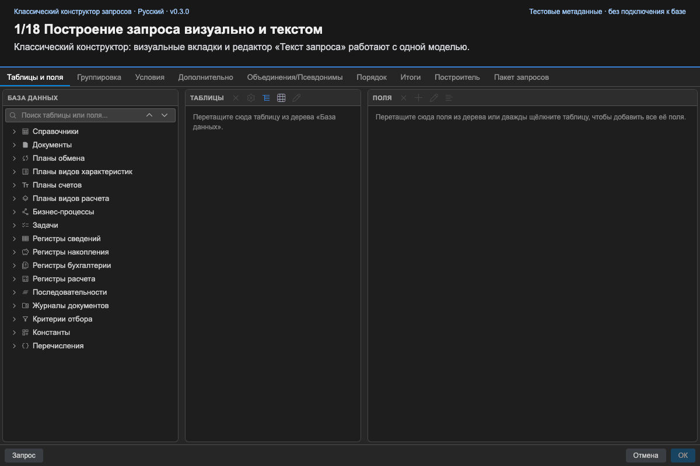

<!--
source_version: 6
translation_status: current
-->

<h1>
  <a href="../ru/query-designer.md" title="Русский">
    <picture>
      <source media="(max-width: 1000px)" srcset="../../assets/images/lang/ru-icon-active.svg">
      
    </picture>
  </a>
  <a href="../uk/query-designer.md" title="Українська">
    <picture>
      <source media="(max-width: 1000px)" srcset="../../assets/images/lang/uk-icon.svg">
      
    </picture>
  </a>
  <a href="../en/query-designer.md" title="English">
    <picture>
      <source media="(max-width: 1000px)" srcset="../../assets/images/lang/en-icon.svg">
      
    </picture>
  </a>
  🧩 Работа с конструктором запросов
</h1>

Приведённые ниже инструкции с вкладками описывают Classic; Canvas Preview имеет отдельный workflow.

## 🏗️ Построение запроса

В разделе **Таблицы и поля** выберите источники и выходные поля. Дерево
метаданных поддерживает поиск по нескольким словам. Для таблиц доступны поля,
псевдонимы и параметры виртуальных таблиц.

`*` остаётся как написана. **Развернуть \*** в списке полей заменяет её
колонками из метаданных конфигурации после подтверждения: колонки берутся из
выгрузки конфигурации, поэтому реквизиты расширений конфигурации и более поздние
изменения не учтены. Команда доступна для таблиц конфигурации без табличных
частей вне объединения; подсказка кнопки называет причину, когда она недоступна.

Остальные вкладки управляют соединениями, условиями, группировкой, сортировкой,
итогами, объединениями, индексами и дополнительными параметрами. **Пакет**
управляет несколькими операторами и временными таблицами. **Конструктор
выражения** помогает работать с полями, операторами, функциями и параметрами.

## 🔍 Проверка сгенерированного текста

Откройте **Текст запроса**, чтобы просмотреть SDBL. Редактор поддерживает
подсветку, форматирование, поиск, маркеры проверки и панели структуры и параметров.
Закрытие с непримененными изменениями требует подтверждения; **Отмена** никогда
не меняет конструктор.

Ручные изменения текста разбираются обратно в `QueryModel`. Если грамматика не
поддерживается, конструктор показывает ошибку и сохраняет предыдущую модель.

## ✅ Завершение

Нажмите **ОК**, чтобы передать код в редактор, или **Отмена**, чтобы отбросить
изменения. Если открыт существующий запрос и ничего не изменено, **ОК** (и
**Сохранить** в Canvas) оставляет строку BSL без изменений. Обновление кеша метаданных не редактирует текущий BSL-файл.

## 🧪 Canvas Preview

Включите `queryConsole.enableNewBuilderPreview` и выполните **1C: Новый конструктор (Preview)**.
Шесть рабочих пространств управляют структурой, полями, условиями, группировкой,
сортировкой и дополнительными параметрами; пакет/UNION используют модель Classic.
Войдите в подзапрос-источник для рекурсивного редактирования: **Назад** проверяет и
принимает draft, **Отмена** оставляет родительский запрос неизменным. Доступны
основные формы VT, описания внешних временных таблиц, итоги/индексы и редактор выражений.

Панель сгенерированного SDBL имеет подсветку, копирование, изменение размера и
сворачивание; текст в ней только для чтения. **Сохранить** вставляет проверенный
текст и не выполняет запрос. Сложные загруженные формы могут только сохраняться
без отдельных controls; см. [актуальную матрицу](../design/new-builder/feature-baseline.md)
и [ограничения](limitations.md). Функциональный baseline отделён от UX/accessibility
и готовности релиза, поэтому Preview включается только по выбору пользователя.

## 🎬 Сценарий демонстрации

[Посмотреть видео (WebM)](../videos/query-constructor-demo.ru.webm).
Запись использует актуальный Classic WebView и небольшой набор метаданных из E2E-тестов.
Приватная конфигурация не нужна.

1. Найдите `Валюты Наим`: слова могут соответствовать и таблице, и её полю.
2. Перетащите `Наименование` в **Поля**. Исходная таблица добавится автоматически.
3. Дважды щёлкните выбранную таблицу `Валюты`, чтобы добавить все поля. Повторы разрешены:
   повторное `Наименование` генерируется с псевдонимом `Наименование1`.
4. Нажмите **+** в панели **Поля**, чтобы открыть новый редактор **Произвольное выражение**.
   Найдите поле и дважды щёлкните его, чтобы вставить и увидеть тип. Выделите текст,
   найдите `ЕСТЬNULL` и вставьте шаблон со встроенной справкой по синтаксису.
   Наберите `Валюты.`, выберите поле из подсказок и нажмите **Tab** для второго
   аргумента. Незавершённое выражение показывает синтаксическую ошибку и отключает
   форматирование; диагностика не блокирует **ОК** в этом диалоге. Исправьте выражение
   на `ЕСТЬNULL(Валюты.Наименование, "-")` и сохраните как поле результата.
5. Откройте **Запрос** в редакторе **Текст запроса**. **Структура** показывает поля
   результата и источники рядом с SDBL. Добавьте `ГДЕ Валюты.Код = &Код` и сортировку
   по убыванию, нажмите **Форматировать** и **Проверить** на панели инструментов.
6. Откройте **Параметры**, чтобы увидеть `&Код` и число использований. Щёлкните
   параметр для перехода к его строке, затем нажмите **Применить**.
   Проверьте **Условия** и **Порядок**: правки уже в модели.
7. Попробуйте неизвестную исходную таблицу. Проверка показывает диагностику и маркер
   ошибки; применение правки сохраняет прежнюю модель. Закройте диалог, подтвердите
   **Закрыть без сохранения** и снова откройте **Запрос**: корректная модель сохранена.
8. **ОК** передаёт SDBL хосту расширения для вставки в BSL, а не выполняет запрос
   к базе. Браузерная запись не показывает вставку в редактор VS Code.

Язык интерфейса и пояснений соответствует языку документации. Идентификаторы метаданных
и ключевые слова SDBL не меняются. Экспериментальный Canvas в этой записи выключен;
другие настройки не нужны.
